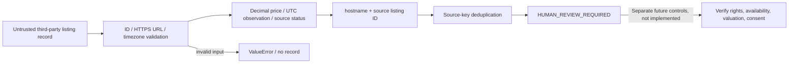

# Revenue Intake — Source-to-Review Architecture

**Status:** synthetic Python proof of concept. No live feed, CRM write, marketing or revenue outcome is claimed.



## Trust boundaries and design choices

| Boundary | Behavior | Remaining risk |
| --- | --- | --- |
| Untrusted source | Reject missing/oversized ID, invalid HTTPS URL, naive observation time | URL validation is not a full SSRF/host reputation defense |
| Money | Decimal conversion; nonpositive/invalid values become null | Asking price and ARV remain unverified |
| Status | `available`, `pending`, `sold`, `unknown` only | Availability is source-asserted, not independently checked |
| Identity | `hostname:source_listing_id` deduplication | Does not resolve same property across different sources |
| Human gate | `distribution_authorized=false`, `publishable=false`, `automated_marketing_eligible=false` | No implementation of rights verification or CRM approval |
| Privacy | Pure functions; no network, contacts, credentials or outbound tools | Real operational controls require separate review |

## Reproduce

Python 3.10+, no third-party packages:

```bash
PYTHONPATH=src python -m unittest discover -s tests -v
```

See [synthetic example](synthetic-demo.md) for a runnable local example and expected fields. Current source defines eight `test_*` methods; the README's eight-pass result is historical (2026-10-14), independently reproduced offline on 2026-10-29: 8 tests, OK.

## Failure/limitation policy

Invalid IDs, non-HTTPS URLs or missing timezone raise `ValueError`. Invalid prices do not become trustworthy prices; they become null and add review flags. Pending/sold/unknown never become automatically marketable. Duplicate keys collapse only within the same hostname/source ID. No contract rights, marketing permission, buyer consent, realized profit, or production integration can be inferred from this module.
