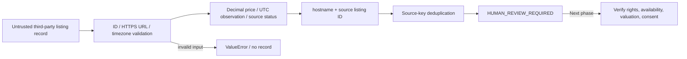

# Revenue Intake — Source-to-Review Architecture

**Status:** Python proof of concept running on synthetic data.



## Trust boundaries and design choices

| Boundary | Behavior | Handled next by |
| --- | --- | --- |
| Untrusted source | Reject missing/oversized ID, invalid HTTPS URL, naive observation time | Network-level host checks in the live integration |
| Money | Decimal conversion; nonpositive/invalid values become null | Human underwriting review |
| Status | `available`, `pending`, `sold`, `unknown` only | Human confirmation with the source |
| Identity | `hostname:source_listing_id` deduplication | Cross-source matching (roadmap) |
| Human gate | `distribution_authorized=false`, `publishable=false`, `automated_marketing_eligible=false` | Rights verification and CRM approval (roadmap) |
| Privacy | Pure functions; no network, contacts, credentials or outbound tools | Operational controls in the live integration |

## Reproduce

Python 3.10+, no third-party packages:

```bash
PYTHONPATH=src python -m unittest discover -s tests -v
```

See [synthetic example](synthetic-demo.md) for a runnable local example and expected fields. All 8 tests pass and run automatically on every push.

## Failure policy

Invalid IDs, non-HTTPS URLs or missing timezone raise `ValueError`. Invalid prices do not become trustworthy prices; they become null and add review flags. Pending/sold/unknown never become automatically marketable. Duplicate keys collapse only within the same hostname/source ID. Contract rights, marketing permission and buyer consent are confirmed by human review before anything moves forward.
